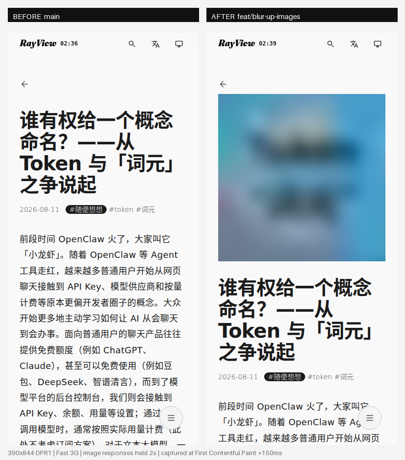
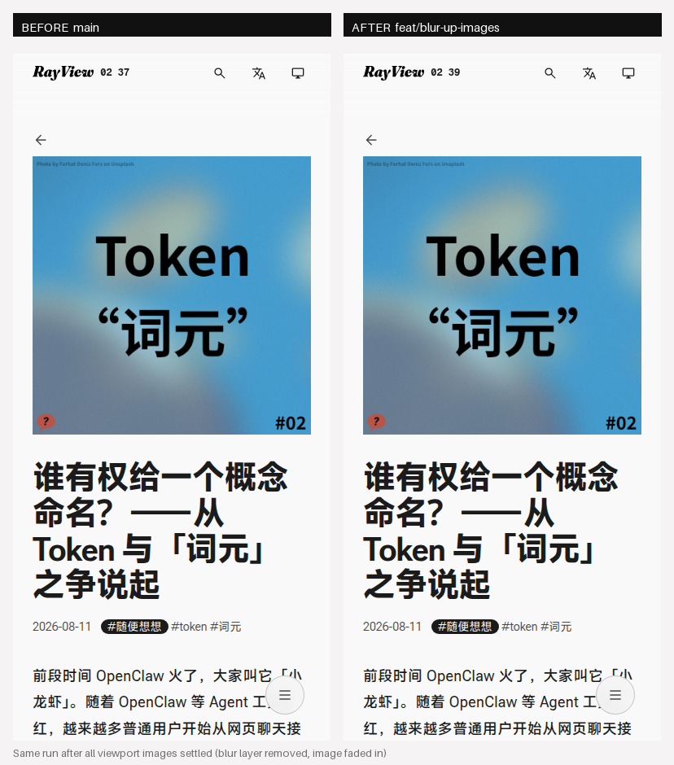
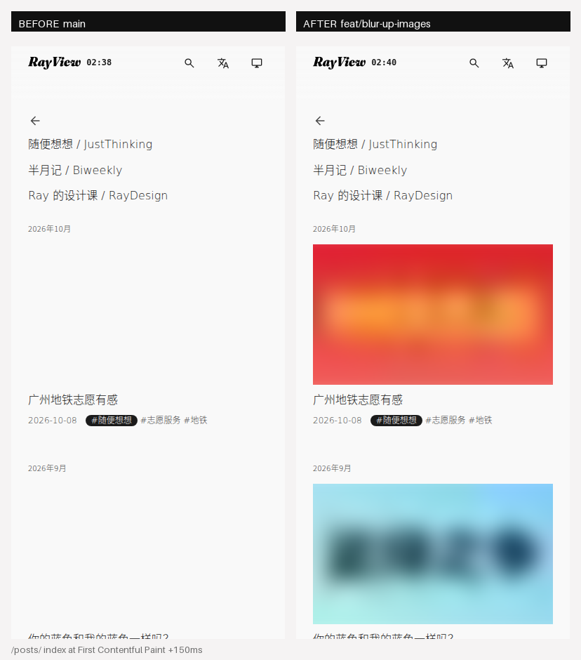

# RAY-608 自测记录：图片 blur-up 懒加载

对应 GitHub issue [#87](https://github.com/RayySummers/raysview/issues/87)。

## 改了什么

| # | 文件 | 改动 |
|---|---|---|
| 1 | `astro.config.mjs` | 新增 rehype 插件 `rehypeBlurUpImages`：正文 `` 就地包成 `<span class="blur-up">` + 占位层，补 `width/height`、`loading="lazy"`、`decoding="async"` |
| 2 | `src/components/BlurUpImage.astro` | 新组件：封面 / 列表卡片这些手写 `` 走同一套结构，支持 `eager` / `fill` / `ratio` |
| 3 | `src/lib/blur-up.mjs` | 占位数据查表 + 内联 CSS 变量拼装 |
| 4 | `src/data/image-meta.json` | 41 张图的元数据（原始宽高 + 24px 宽 webp 占位，15.8 KB，入库） |
| 5 | `scripts/gen-image-meta.mjs` | 生成上面那份 JSON 的一次性脚本（`pnpm images:meta`，可重复执行，只补新增图） |
| 6 | `src/styles/global.css` | `.blur-up` 系列样式：容器 `aspect-ratio`、占位层 `blur(12px)`、高清淡入、`prefers-reduced-motion` 直切、6s 兜底动画 |
| 7 | `src/layouts/Base.astro` | `<head>` 内联经典脚本：打 `has-js`、监听图片 `load`、淡入后移除占位层 |
| 8 | `src/components/pages/{ArticlePage,PostListPage,SeriesPage}.astro` | 手写 `` 换成 `<BlurUpImage>`；文章封面 `eager`，列表首张封面 `eager`、其余懒加载 |
| 9 | `.github/scripts/check-build.sh` | 新增 RAY-608 产物断言（见「五」） |

**没动的**：`DESIGN.md` 的字体/颜色/间距、作者侧 markdown 写法（仍是 ``）、图片地址（不换 CDN、不挪文件）、灯箱逻辑（`[data-zoomable]` 语义不变）。

## 一、选型：rehype 插件，不是 Astro 内置 `<Image>`

两条路都试算过，选插件的原因：

1. **`<Image>` 要求图片能被 Vite 导入**（`src/assets` 里的资源）。本站封面都在 `public/images/`，而且 frontmatter 里的路径还被 OG / JSON-LD / 分享卡片当 URL 直接引用；正文图更全是外链图床（imgdb）。迁到 `src/assets` 等于挪文件 + 改 content schema + 改 OG 生成逻辑 —— 与本单「不改作者侧写法」的目标相反。
2. **`<Image>` 也不会生成 24px 模糊占位**。它输出的是 srcset 与宽高；blur-up 仍要自己解码一张缩略图，等于两条路都要写插件，还多一层。
3. 插件在渲染层统一加壳，正文、脚注、以后新加的文章全部自动覆盖，没有遗漏；页面里手写的 ``（封面、列表卡片）走同一个组件的同一套 CSS。

## 二、占位数据从哪来（构建期不联网、不依赖 sharp）

`src/data/image-meta.json` 每条 = `{ w, h, lqip }`：

```json
"/images/posts/welcome-banner.jpg": {
  "w": 1600, "h": 681,
  "lqip": "data:image/webp;base64,UklGR…"   // 24px 宽、q40，平均 253 B
}
```

- 站内图直接读 `public/` 下的文件；正文外链图由脚本抓一次（只把缩略图与宽高写进 JSON，运行时仍走原地址）。
- **构建只查表**：`pnpm build` 不发任何图片请求，CI 不受图床限流/离线影响，产物可复现。
- 新增或替换图片后跑 `pnpm images:meta` 补数据（可重复执行，只生成缺的那些；图床慢可加 `IMAGE_META_TIMEOUT_MS=120000`）。
- 没有元数据的图（忘了跑脚本 / 图挂了）自动退化成普通 ``：仍有 `lazy` + `async`，只是没有占位层与固定比例，不会白屏也不会报错。

> 踩坑记录：改了 rehype 插件后，Astro 会复用 `.astro/` 与 `node_modules/.astro/data-store.json` 里的正文缓存，产物不会变。调插件时先 `rm -rf .astro node_modules/.astro` 再 build（CI 是干净 checkout，不受影响）。

## 三、实测：3G 节流，改造前 vs 改造后

口径（`verify.mjs`）：Chromium 151、视口 390×844 @DPR1、缓存关闭、CDP `Network.emulateNetworkConditions` 走 Chrome 的 Fast 3G 预设（1.6 Mbps / 150 ms RTT）。**所有图片请求统一延迟 2 s 才应答** —— 本地静态服务的图没有真实网络延迟，不固定延迟就采不到「图片比首绘晚到」的那一帧；两边同样处理，对比成立。截图时刻以 First Contentful Paint 为基准。

`before` = `main`（9f4f665）构建，`after` = 本分支构建。

| 页面 | 指标 | before | after | 变化 |
|---|---|---|---|---|
| 文章页 `/posts/justthinking/justthinking-02-token-ciyuan/` | CLS | **0.2699** | **0.0004** | −99.9% |
| | 标题被顶下去的距离 | 342 px | 0 px | 不再跳动 |
| | 图片请求数 / 字节 | 5 个 / 1917 KB | 3 个 / 814 KB | 请求 −40%，字节 −58% |
| 列表页 `/posts/` | CLS | 0.0002 | 0.0002 | 不变 |
| | 图片请求数 / 字节 | 8 个 / 1994 KB | 7 个 / 1916 KB | 懒加载阈值内仍会预取，见「六」 |

桌面端另测了一篇长文 `/posts/raydesign/emoji-everything/`（1280px 视口、19 张正文图）：改造前后页面总高都是 **16972 px**，19 张图的高度逐张一致；改造后只真正下载了 2 张，其余位置全部由 `aspect-ratio` 先占好 —— 布局不再取决于图片什么时候到。

首绘那一帧的对比（左：`main`，右：本分支）：



图片到齐后的对比 —— 最终观感不变，只是中间不再空白：



列表页首绘（左边整块空白是 200px 高的卡片位，右边已经是模糊占位）：



### 运行时断言（同一篇文章页）

| 场景 | 期望 | 实测 |
|---|---|---|
| `prefers-reduced-motion: reduce` | 占位层立刻移除、无过渡、高清图可见 | `firstBoxHasPlaceholder=false`、`transition-duration=0s`、`opacity=1` ✅ |
| 脚本没跑（摘掉 `has-js`） | 高清图照常可见（没有 JS 也不能白图） | `opacity=1` ✅ |
| 正常加载 | 淡入后占位层被移除 | 已加载的 2 个容器 `is-loaded`，对应占位层已从 DOM 移除（剩 2 个属于视口外还没加载的懒图）✅ |

## 四、验收清单

- [x] 构建时为每张站内图片生成极小缩略图（24px 宽，base64 内联进 CSS 变量 `--blur-up-lqip`）
- [x] 图片容器固定 `aspect-ratio`（取图片自然比例）→ 标题位移 342px → 0px，CLS 0.2699 → 0.0004
- [x] 高清图加载完成后淡入（200ms `ease-out`，≤300ms），占位层 `transitionend` 后从 DOM 移除
- [x] `` 带 `loading="lazy"` + `decoding="async"`；文章封面与列表首图保持 `eager` + `fetchpriority="high"`
- [x] 尊重 `prefers-reduced-motion`：该偏好下无过渡、占位层立即移除
- [x] 不改作者侧 markdown 写法（rehype 插件方案，选型理由见「一」）
- [x] `pnpm build` 通过；3G 节流下改造前/后对比截图见上

## 五、回归闸门（`check-build.sh`）

新增 8 条产物断言，任何一条回退都会让部署 job 变红：

1. 带 blur-up 的图片 ≥ 20 张（数量异常说明插件没生效）；
2. 每张 blur-up 图都有 `decoding="async"`；
3. 每张 blur-up 图都有 `loading`（lazy / eager 二选一）；
4. 除页头 logo 与公众号图标外，产物里没有裸 ``；
5. `.blur-up` 容器数与 blur-up 图片数一致；
6. 每个容器都带 `--blur-up-ratio`（防跳动）；
7. 每个容器都带 `--blur-up-lqip`（占位图）；
8. 文章封面是 `eager` + `fetchpriority="high"`；列表页有且只有第一张封面 `eager`；CSS 里有 `blur(12px)` 与 `prefers-reduced-motion` 直切规则；`<head>` 里有 `has-js` 增强脚本。

## 六、已知取舍与后续

- **图片本身没有换尺寸**：本单只解决「空白 / 跳动 / 白等」，没有做响应式 `srcset`。1600×1600 的封面在手机上仍是原图（约 500 KB）—— 那是另一个更大的优化项（需要把封面迁到 `src/assets` 用 `<Image>` 出多档尺寸），建议单独开单。
- **Chrome 的懒加载阈值很宽**：视口外 1250 px 内的图仍会预取，所以列表页只比改造前少 1 个请求；字节主要省在正文长文（1917 → 814 KB）。
- **正文小图不拉伸**：`--blur-up-max-width` 取图片原生宽度，710px 的贴纸截图保持原尺寸显示，与改造前 `max-width:100%` 的观感一致。
- 站外图床的图仍按 `verify.mjs` 的固定延迟出现在截图里；生产环境的真实到达时间取决于 imgdb。

## 七、复现

```bash
# 1) 两份构建
git switch main && pnpm build && mv dist dist-before
git switch feat/blur-up-images && pnpm build

# 2) 两个静态服务
python3 -m http.server 46081 --directory dist-before &
python3 -m http.server 46082 --directory dist &

# 3) 跑两遍（playwright：npm i -g playwright 后 `npm link playwright`）
cd docs/qa/RAY-608
node verify.mjs http://127.0.0.1:46081 readings-before.json shots before fast3g
node verify.mjs http://127.0.0.1:46082 readings-after.json shots after fast3g

# 4) 产物自检
cd ../../.. && DIST_DIR=dist bash .github/scripts/check-build.sh
```
