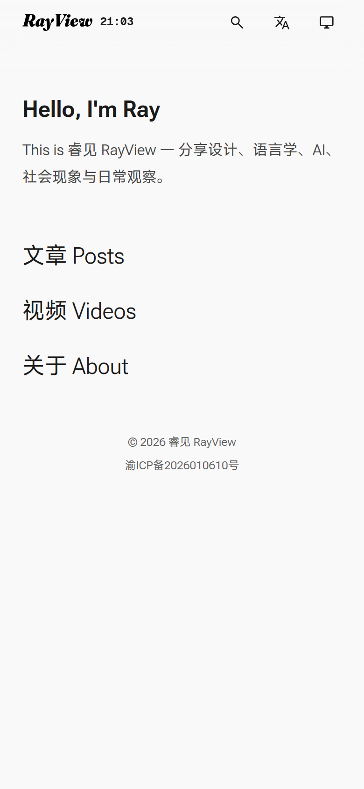
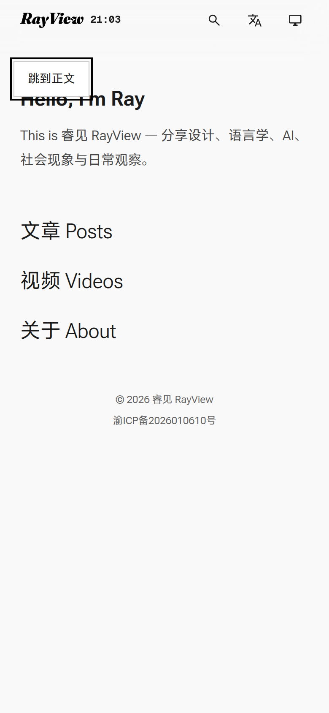

# RAY-627 自测记录：skip link 常驻可见（压住 header）修复

## 改了什么

| # | 文件 | 位置 | 改动 |
|---|---|---|---|
| 1 | `src/styles/global.css` | `.skip-link` / `.skip-link:focus` | 隐藏方式从 `top:72px + transform:translateY(-200%)` 换成 visually-hidden（1×1 + `clip-path:inset(50%)`），聚焦时再恢复成左上角的固定按钮；去掉 transform 与 transition |

**没动的**：`src/layouts/Base.astro` 里的 `<a class="skip-link" href="#main">跳到正文</a>` 原样保留（无障碍要求，键盘可达）；其它 CSS、header、`#main` 的 `tabindex="-1"` 都没改。

## 根因

原规则（PR #94）：

```css
.skip-link {
  position: fixed;
  top: 72px;
  transform: translateY(-200%);
  transition: transform 150ms ease-out;
}
.skip-link:focus-visible { transform: translateY(0); }
```

`translateY` 的百分比按**元素自身高度**计算，不是视口高度。本页按钮实测高 46.8px，
-200% 只上移 93.6px，起点 `top:72px` 推完仍在 `-21.6px`，底部 25.2px 露在视口里
（同一构建里用内联样式还原旧规则实测：`top=-21.59`、`bottom=25.20`，header 底边 48px，
即约 25px 压在 header 上）。于是首屏无需交互就能看到它。

## 修法

```
默认：position:absolute; width:1px; height:1px; padding:0; margin:-1px; border:0;
      overflow:hidden; clip-path:inset(50%); white-space:nowrap; transition:none
聚焦：position:fixed; top:72px; left:var(--space-3); width/height:auto; clip-path:none;
      恢复背景/边框/圆角/字号 + outline
```

- 不再使用 `transform` 的百分比语义，隐藏与位置彻底解耦。
- 用 `:focus` 而不是 `:focus-visible`：skip link 的价值就是键盘聚焦即出现，
  鼠标点击后也不该留在屏幕上（点击会立即导航走）。
- 全程没有 `transition` / `animation`，`prefers-reduced-motion: reduce` 下自然也没有动画，
  不需要额外的媒体查询分支。

## 验收结果

构建：`pnpm build`（Astro 6.3.5，44 页，0 错误）。
浏览器：系统 Chrome（Playwright，headless），手机视口 390×844 @2x，桌面 1440×900 @1x。
复跑命令：

```bash
pnpm build
pnpm preview --port 4321 --host 127.0.0.1
python3 docs/qa/RAY-627/verify.py http://127.0.0.1:4321
```

`verify.py` 全部断言通过（`ALL ASSERTIONS PASSED`），读数存于 `results.json`：

| 验收项 | 读数 | 结论 |
|---|---|---|
| 1. 390 默认态不可见 | rect 1×1 @ (-1,-1)，`clip-path: inset(50%)`；在 header 区域 5×7 个采样点做 `elementFromPoint`，命中 skip link 0 次 | ✅ |
| 1. 1440 默认态不可见 | 同上，命中 0 次 | ✅ |
| 2. Tab 一次后完整出现 | `document.activeElement` = `.skip-link`；rect `{x:16, y:72, w:90, h:43.19}`，完整落在 390×844 视口内 | ✅ |
| 2. 不遮 header 时钟 | header 底边 48px，按钮顶边 72px（72 ≥ 48），无重叠 | ✅ |
| 3. 回车跳转 | `location.hash = "#main"`，`activeElement = MAIN#main`，`#main` 顶边对齐 48px | ✅ |
| 3. 点击跳转 | 同上 | ✅ |
| 4. reduced-motion | `transition-duration: 0s`，`animation-name: none`；聚焦态仍完整出现 | ✅ |
| 5. 截图 | `390-default.png`、`390-focus.png`（390px 宽 @2x）；另附 `1440-default.png` | ✅ |

## 截图

默认态（390px，无按钮）：



Tab 聚焦态（390px，按钮完整出现在左上角，位于 header 之下）：



## 说明 / 未覆盖

- 只在 Chrome（headless）验证；未上真机 iOS/Android。读数与截图都来自本地 `dist` 预览。
- 按钮聚焦时位于 `top:72px`，会盖住正文第一行标题的顶部（这是描述里指定的位置，且不再压 header）；
  若后续希望完全避开正文，可另开单调整落点。
